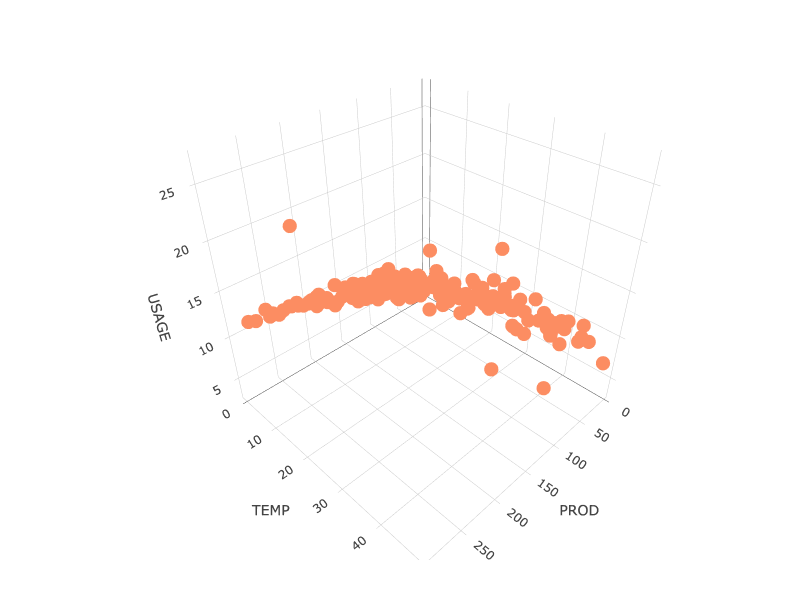
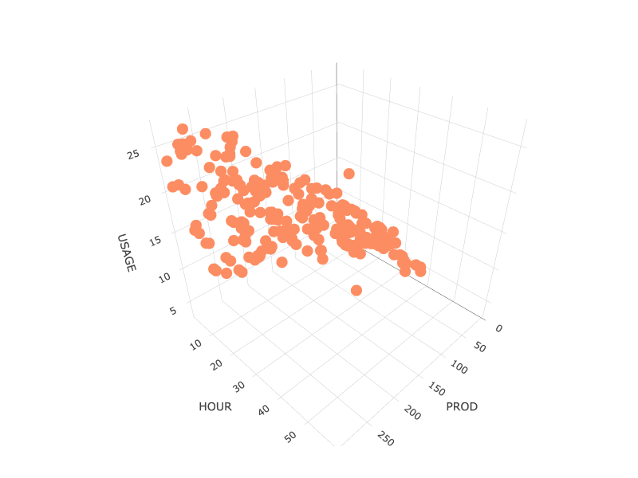
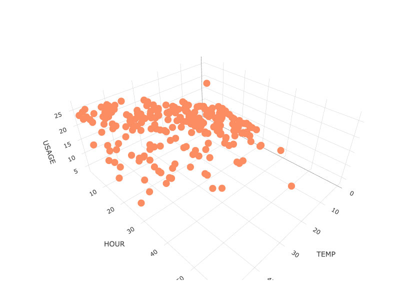

# Multiple Regression and Model Selection: Three Applied Case Studies

Statistical modelling in R across three domains: industrial operations, higher education finance, and power generation engineering. In each case I fit a full linear model, tested which predictors belong in it, tested for interaction effects, and chose a final model for prediction using hypothesis tests, adjusted R², and residual standard error.

Completed for DATA 603 (Statistical Modelling with Data) in the Master of Data Science and Analytics program at the University of Calgary, Fall 2026.

## At a glance

| Case study | Domain | Question | Final model | Adj. R² | Residual SE |
|------------|------------|------------|------------|------------|------------|
| Water usage | Manufacturing | What drives a plant's monthly water consumption? | PROD, TEMP, HOUR + PROD×TEMP + PROD×HOUR | 0.9647 | 0.9866 gal/min |
| Student debt | Higher education finance | Does a school's cost predict the debt its students take on? | Annual cost, SAT + Cost×SAT | 0.2192 | 3.758 |
| Gas turbine | Energy engineering | Which operating conditions drive turbine heat rate? | RPM, INLET.TEMP, EXH.TEMP, AIRFLOW + INLET.TEMP×AIRFLOW + EXH.TEMP×AIRFLOW | 0.9366 | 401.35 kJ/kWh |

## Skills demonstrated

- Building and comparing multiple linear regression models in R
- Global F-tests, individual t-tests, and partial F-tests
- Confidence intervals for coefficients
- Detecting and testing interaction effects
- Backward elimination with `olsrr`
- Confidence intervals versus prediction intervals
- Interpreting model coefficients in the context of the problem

## Method

The approach I take to linear regression models with quantitative predictors:

1.  **Fit the full first-order model** and run a global F-test to check whether at least one predictor is useful.
2.  **Test each predictor** with an individual t-test and a 95% confidence interval.
3.  **Confirm removals with a partial F-test** comparing the full and reduced models.
4.  **Look for interactions** using 3D plots, a model with all two-way interactions, and backward elimination.
5.  **Keep main effects** when their interaction terms are significant.
6.  **Choose the final model** using adjusted R² and residual standard error, then interpret it and make predictions.

## Case 1: Industrial water usage

**Data.** The amount of water used by the production facilities of a plant varies. Observations on water usage and other, possibly related, variables were collected for 250 months.

| Variable | Role      | Description                                       |
|----------|-----------|---------------------------------------------------|
| USAGE    | Response  | Monthly water usage (gallons/minute)              |
| PROD     | Predictor | Amount of production (hundreds of cubic units)    |
| TEMP     | Predictor | Average monthly temperature (degrees Celsius)     |
| HOUR     | Predictor | Number of hours shut down for maintenance (hours) |
| DAYS     | Predictor | Number of operating days in the month (days)      |

**Full model.**

$$
\widehat{\text{USAGE}} = 5.892 + 0.040\,\text{PROD} + 0.169\,\text{TEMP} - 0.070\,\text{HOUR} - 0.0216\,\text{DAYS}
$$

The global F-test was significant (F = 486.017, p ≈ 0), so usage can be expressed as a linear function of at least one predictor.

**Removing DAYS.** DAYS failed its t-test (t = −0.672, p = 0.502), and its 95% confidence interval of −0.0850 to 0.0417 contains zero. A partial F-test confirmed it should be removed (F = 0.4515, p = 0.5022). The remaining predictors were all significant: PROD (t = 24.741), TEMP (t = 20.723), and HOUR (t = −4.170, p = 0.0000423).

| Model                  | Adj. R² | Residual SE |
|------------------------|---------|-------------|
| Full (4 predictors)    | 0.8867  | 1.768       |
| Reduced (DAYS removed) | 0.8869  | 1.766       |

With PROD and HOUR held constant, each 1 °C increase in average temperature raises water usage by 0.153 to 0.185 gal/min (95% confidence).

**Interactions.** The 3D plot of PROD, TEMP, and USAGE showed a contour that suggested an interaction.



| 3D plot of PROD, HOUR and USAGE     | 3D plot of TEMP, HOUR and USAGE     |
|------------------------------------|------------------------------------|
|  |  |

A model with all two-way interactions was significant overall (F = 1131). PROD×TEMP (t = 17.154) and PROD×HOUR (t = 9.933) were significant. TEMP×HOUR was not (t = 0.989, p = 0.324), so I removed it. In the reduced interaction model, both remaining interactions stayed significant: PROD×TEMP (t = 22.795) and PROD×HOUR (t = 10.165).

**Result.** The final interaction model explains 96.47% of the variation in monthly water usage, up from 88.69%. Its average prediction error is 0.9866 gal/min, down from 1.766.

**Final proposed model.**

$$
\begin{aligned}
\widehat{\text{USAGE}} = \; & 12.426 - 0.00253\,\text{PROD} - 0.00474\,\text{TEMP} - 0.2151\,\text{HOUR} \\
& + 0.001142\,(\text{PROD} \times \text{TEMP}) + 0.000787\,(\text{PROD} \times \text{HOUR})
\end{aligned}
$$

## Case 2: College student debt

**Data.** Data collected on 80 colleges and universities in the United States.

| Variable | Role | Description |
|------------------------|------------------------|------------------------|
| Average.Indebtedness | Response | The mean debt a student attending the school incurs per year |
| Annual.Total.Cost | Predictor | The annual total cost of attending the school (tuition, living expenses, and other associated educational costs) |
| Room.and.Board | Predictor | The amount a student pays for room and board per year (in \$1000s of USD) |
| Average.Total.SAT | Predictor | The mean SAT (a college and university entrance test) of all students enrolled in the school |
| Type.of.School | Not used in the models | The type of school (0 = public, 1 = private) |

**Full model.**

$$
\widehat{\text{Average.Indebtedness}} = 13.944 + 0.434\,\text{Annual.Total.Cost} - 0.130\,\text{Room.and.Board} - 0.0076\,\text{Average.Total.SAT}
$$

| Statistic     | Value                   |
|---------------|-------------------------|
| SSE           | 1135.124                |
| Residual SE   | 3.8647                  |
| Adj. R²       | 0.1744                  |
| Global F-test | F = 6.562, p = 0.000527 |

The model explains 17.44% of the variation in student debt, and the global F-test shows at least one predictor is useful.

**Does higher cost lead to more debt?** Holding room and board and SAT constant, the test on annual total cost gave t = 3.106 and p = 0.00267. A \$1,000 increase in annual cost leads to an increase in average student debt.

**Interaction model.** The Cost×SAT interaction was significant (t = −2.106, p = 0.0385), and its confidence interval of −0.0027 to −0.00007 does not contain zero.

| Model                   | Adj. R² | Residual SE |
|-------------------------|---------|-------------|
| Original (3 predictors) | 0.1744  | 3.865       |
| Interaction model       | 0.2192  | 3.758       |

**Result.** The interaction model explains 21.92% of the variation and has a lower average error, so I used it for prediction.

- **Prediction interval** for a school with a \$15,500 annual cost and an average SAT of 1310: 3,957.38 to 19,916.42 USD (95%).
- **Confidence interval for the mean** at a \$14,500 annual cost and an average SAT of 1105: 10,021.70 to 12,436.64 USD (95%).

**Final proposed model.**

$$
\begin{aligned}
\widehat{\text{Average.Indebtedness}} = \; & {-21.098} + 2.0466\,\text{Annual.Total.Cost} + 0.02266\,\text{Average.Total.SAT} \\
& - 0.001397\,(\text{Annual.Total.Cost} \times \text{Average.Total.SAT})
\end{aligned}
$$

## Case 3: Gas turbine heat rate

**Data.** From a *Journal of Engineering for Gas Turbines and Power* (January 2005) study of a high pressure inlet fogging method for gas turbine engines. The heat rate was measured for each of 67 gas turbines augmented with high pressure inlet fogging, along with several other operating variables.

| Variable   | Role      | Description                                  |
|------------|-----------|----------------------------------------------|
| HEATRATE   | Response  | Heat rate (kilojoules per kilowatt per hour) |
| RPM        | Predictor | Cycle speed (revolutions per minute)         |
| INLET.TEMP | Predictor | Inlet temperature (degrees Celsius)          |
| EXH.TEMP   | Predictor | Exhaust gas temperature (degrees Celsius)    |
| CPRATIO    | Predictor | Cycle pressure ratio                         |
| AIRFLOW    | Predictor | Air mass flow rate (kilograms per second)    |

**Full model.**

$$
\widehat{\text{HEATRATE}} = 13614.461 + 0.0888\,\text{RPM} - 9.200\,\text{INLET.TEMP} + 14.394\,\text{EXH.TEMP} + 0.352\,\text{CPRATIO} - 0.848\,\text{AIRFLOW}
$$

The global F-test was significant at α = 0.01 (F = 147.30, p ≈ 0).

**Removing CPRATIO.** CPRATIO failed its t-test (t = 0.012, p = 0.9905), and a partial F-test confirmed it should be removed (p = 0.9905). At α = 0.06, the remaining predictors were all significant: RPM (t = 6.608), INLET.TEMP (t = −11.923), EXH.TEMP (t = 6.356), and AIRFLOW (t = −1.939, p = 0.0570).

**Interactions.** I ran backward elimination over all two-way interactions at α = 0.06. It kept INLET.TEMP×AIRFLOW (t = 4.432, p = 0.0000402) and EXH.TEMP×AIRFLOW (t = −3.816, p = 0.000323). The final model was significant overall (F = 163.7).

**Result.** The final model explains 93.66% of the variation in heat rate. Its average prediction error is 401.35 kJ/kWh. Compared with the reduced additive model, it has a higher adjusted R² and a lower residual standard error.

**Final proposed model.**

$$
\begin{aligned}
\widehat{\text{HEATRATE}} = \; & 13603.30 + 0.0452\,\text{RPM} - 12.79\,\text{INLET.TEMP} + 23.27\,\text{EXH.TEMP} + 1.34\,\text{AIRFLOW} \\
& + 0.016\,(\text{INLET.TEMP} \times \text{AIRFLOW}) - 0.041\,(\text{EXH.TEMP} \times \text{AIRFLOW})
\end{aligned}
$$

## Full analysis

Every hypothesis test, with its hypotheses, test statistic, p-value, and conclusion, is in [analysis/original_coursework.md](analysis/original_coursework.md).

## Repository structure

```         
README.md
analysis/original_coursework.Rmd   Full analysis in R Markdown
analysis/original_coursework.md    Rendered version, readable on GitHub
R/make_3d_plots.R                  Builds the 3D plots in figures/
figures/                           3D plots of the water usage data
```

## Reproduce

Requires R 4.1 or later. Data is read directly from the public source URLs.

``` r
install.packages(c("ggplot2", "mosaic", "plotly", "olsrr", "htmlwidgets", "webshot2"))
rmarkdown::render("analysis/original_coursework.Rmd")
```

## Data sources

- Water usage and gas turbine data: [Thuntida/dataset](https://github.com/Thuntida/dataset)
- College data: [Statman44/Data602](https://github.com/Statman44/Data602)
